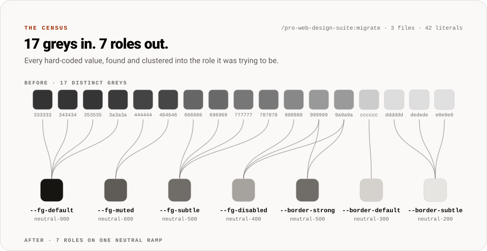
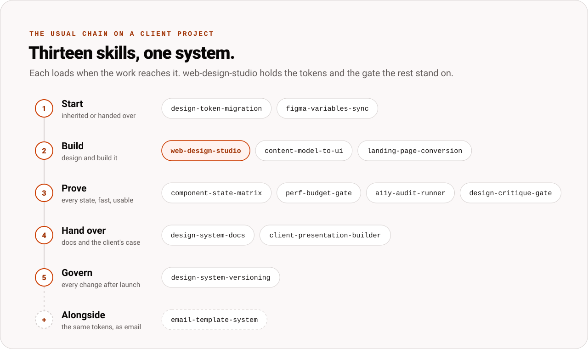
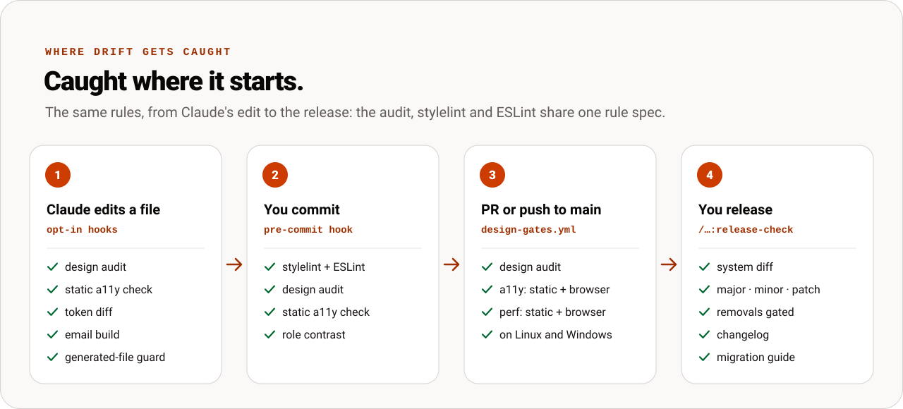

<div align="center">

<picture>
  <source media="(prefers-color-scheme: dark)" srcset=".github/assets/readme/hero-dark.svg">
  
</picture>

<br><br>

[](https://github.com/Vybecode-LTD/Pro-Web-Designer-Suite-Plug-in/releases/latest)
[](https://github.com/Vybecode-LTD/Pro-Web-Designer-Suite-Plug-in/releases)
[](https://github.com/Vybecode-LTD/Pro-Web-Designer-Suite-Plug-in/actions/workflows/ci.yml)
[](LICENSE)

**[Install](#install)** &nbsp;·&nbsp; **[Quick start](#quick-start-in-60-seconds)** &nbsp;·&nbsp; **[What's inside](#whats-inside)** &nbsp;·&nbsp; **[The gates](#what-the-gates-check)** &nbsp;·&nbsp; **[FAQ](#faq)** &nbsp;·&nbsp; **[Full reference](plugins/pro-web-design-suite/README.md)**

</div>

<br>

**`pro-web-design-suite`** is a Claude Code plugin for building websites that stay coherent when more than one person, or more than one Claude session, touches them. Thirteen skills share one design system: tokens, one home for each component's styles, cascade layers, contrast that is measured rather than assumed, and gates that fail the build on drift.

---

## Why

Most design-system advice is a style guide: a document everyone agrees with and nobody enforces. Six months and three developers later, the site has seventeen greys, five spacing values that are nearly 16px, and a button styled from two files.

This suite turns every rule into a script that can fail. The scripts run after each edit Claude makes (when you turn the hooks on), in a pre-commit hook, and in CI, so drift is caught where it starts instead of in a redesign.

<picture>
  <source media="(prefers-color-scheme: dark)" srcset=".github/assets/readme/census-dark.svg">
  
</picture>

<sub>A real run of <code>/pro-web-design-suite:migrate</code> on a three-file sample: 42 literals, 17 distinct greys among them, each mapped onto the role it was trying to be.</sub>

**It's for you if you:**

- build sites for clients and hand them over to other developers;
- have several developers, or several Claude sessions, editing the same styles;
- maintain a design system and need releases that don't break the sites that use it;
- inherited a codebase full of magic numbers and near-identical colours.

## Install

### Requirements

| You need | For |
|---|---|
| [Claude Code](https://code.claude.com) | The skills, commands, subagents, hooks and MCP server. |
| Python 3.9 or newer | Every gate and script. Standard library only: nothing to `pip install`. |
| Node 20.19+, 22.13+ or 24+ | The hooks, the MCP server, the browser gates, and the shipped ESLint 10 and stylelint 17 configs. |
| `playwright` and `axe-core` in your project | Only the gates that open a page in a browser (runtime accessibility, Core Web Vitals, the state matrix, email rendering). They never download a browser: they use Playwright's own Chromium if it's installed, else your Chrome or Edge. |
| Git and a POSIX `sh` | Only the pre-commit hook. Git for Windows has one. |

### From the plugin marketplace (recommended)

In Claude Code:

```text
/plugin marketplace add Vybecode-LTD/pro-web-design-suite
/plugin install pro-web-design-suite@pro-web-design-suite
```

Then start a new session, so the skills, hooks and MCP server load. [`Vybecode-LTD/pro-web-design-suite`](https://github.com/Vybecode-LTD/pro-web-design-suite) holds the plugin as released, one commit per version, from 4.0.0 on; this repository is where it is developed, and works as a marketplace too. Both are public, so this works for anyone.

### From a release zip

1. Download `pro-web-design-suite-VERSION.zip` from the [latest release](https://github.com/Vybecode-LTD/Pro-Web-Designer-Suite-Plug-in/releases/latest). `SHA256SUMS` beside it lists every asset's hash.
2. Unpack it. The `pro-web-design-suite` folder inside holds `.claude-plugin/marketplace.json`, so it is a marketplace of its own.
3. Add that folder in place of the repository's name, then install:

```text
/plugin marketplace add UNPACKED_FOLDER
/plugin install pro-web-design-suite@pro-web-design-suite
```

<details>
<summary><b>Individual skills, without the plugin</b></summary>

<br>

Each release also attaches one `.skill` file per skill, packaged the way Anthropic's skill-creator packages one. Eight of them run web-design-studio's `audit_design.py` as their gate, so install **web-design-studio** beside any of them. You lose the commands, subagents, hooks and MCP server, which come with the plugin only.

</details>

### Check it works

In a terminal (cmd, PowerShell or bash):

```shell
python --version
node --version
```

Python must be 3.9 or newer. Where `python` is not Python 3 (some macOS installs), the hooks and the MCP server find `python3` or `py -3` themselves, and `WDS_PYTHON` overrides them all.

Then in Claude Code:

```text
/pro-web-design-suite:contrast "#767676" "#ffffff"
```

You should get a ratio of **4.54:1**: a pass for body text at AA, a fail at AAA's 7:1. That proves the plugin loaded and Python runs. Then run `/mcp`: `plugin:pro-web-design-suite:gates` should be connected, with five tools, which proves Node runs.

## Quick start in 60 seconds

**A new site.** Start the system from your brand colour:

```text
/pro-web-design-suite:new-system "#e8440a"
```

That writes the accent and neutral ramps, a type scale and the starter styles to `src/styles`, and checks the contrast of every role pair in light, dark and `.inverse`. Now ask Claude for what you want built, in plain words ("build the pricing page on this system"). The right skills load by themselves. When it's built:

```text
/pro-web-design-suite:gate
/pro-web-design-suite:install-gate
```

The first runs the static halves of the design, accessibility and performance gates, with one verdict. The second puts the gates in your repository and writes the CI workflow that runs them on every pull request and every push to `main`. It shows you what it would write before it writes anything.

**An inherited codebase.** Take a census first. It changes nothing:

```text
/pro-web-design-suite:migrate src
```

You get every hard-coded design value, clustered into the decisions it was trying to be, with a token mapping proposed. Then ask Claude to migrate onto those tokens: it applies the codemod one kind of value at a time, each batch reviewed and committed on its own, and freezes what's left as a baseline, so the gate goes on today and the old debt can only shrink.

## What's inside

<picture>
  <source media="(prefers-color-scheme: dark)" srcset=".github/assets/readme/skill-map-dark.svg">
  
</picture>

### Thirteen skills

Claude loads a skill when your request matches it. You don't have to name it.

| Skill | What it does | Claude reaches for it when you ask to… |
|---|---|---|
| **web-design-studio** | The system: tokens, a closed type and spacing scale, OKLCH colour, cascade layers, layout primitives, 17 navigation patterns, and `audit_design.py`, the gate. | design or build a site, a page or a component |
| **design-token-migration** | Moves an existing codebase onto tokens: census, clusters, `tokens.css`, a codemod, an audit that proves it. | clean up magic numbers and near-identical greys |
| **figma-variables-sync** | Audits Figma designs, generates `tokens.css` from a Figma or Tokens Studio export, pushes tokens back as variables, catches drift in CI. | keep Figma and the code in step |
| **component-state-matrix** | Renders every component at every state, density and theme on one proof sheet, and screenshot-diffs it in CI. | check for visual regressions or missing states |
| **landing-page-conversion** | Positioning, section order and copy for landing, pricing and product pages, audited for conversion. Honest persuasion only. | write or restructure a page that has to sell |
| **design-critique-gate** | An adversarial review with ranked findings, each naming the mechanism behind the problem. | find out whether the work looks professional, before a client sees it |
| **design-system-docs** | Docs generated from the source: a token reference with measured contrast, component API tables, a style guide that fails CI on drift. | document the design system |
| **content-model-to-ui** | Turns a Supabase or Postgres schema into an on-system UI spec and a React scaffold: CRUD screens, forms, list and detail pages, admin panels. | build screens or an admin panel from a database |
| **email-template-system** | Compiles the same tokens into inlined, table-based HTML email that survives Outlook, Gmail and dark mode. | build email templates or newsletters |
| **perf-budget-gate** | Performance budgets that fail the build: page weight on every commit, Core Web Vitals (LCP, CLS, INP) measured on each PR. | set budgets or fix a slow page |
| **a11y-audit-runner** | WCAG 2.2 AA with axe-core, keyboard, focus, contrast and zoom checks in CI, plus the manual pass no tool can make. | audit accessibility or gather VPAT evidence |
| **design-system-versioning** | Classifies each change as major, minor or patch by what renders differently, and writes the changelog, migration guide and codemods. | release a change to the system without breaking its consumers |
| **client-presentation-builder** | Presents the work as reasoning, not taste: decks, rationale, before-and-after comparisons, answers to objections. | present or defend design work to a client or team |

<details>
<summary><b>The Nine Laws every skill enforces</b></summary>

<br>

1. **Tokens or nothing.** Literals live in exactly one file.
2. **Parents own the gaps.** A child never sets its own outer margin.
3. **The scale is closed.** Nothing between the steps.
4. **One home per component's styles.** You can predict its appearance from one file.
5. **Layers, not specificity.** No `!important`, no IDs, nesting depth 2.
6. **Semantic before primitive.** Components read roles, never primitives.
7. **Density is a dial.**
8. **Novel patterns pass the gate.**
9. **Nothing ships un-audited.**

Each skill carries the laws in its `references/token-contract.md`, byte-identical in all thirteen.

</details>

### Sixteen commands

Commands are skills only you invoke, so they stay out of Claude's skill listing. Each is typed after the plugin's name, as in `/pro-web-design-suite:gate`, and typing `/pro-web-design-suite:` lists them all.

| `/pro-web-design-suite:` | What it does |
|---|---|
| `gate` | Runs the design, accessibility and performance gates on the project in one pass, with one verdict. |
| `install-gate` | Vendors the gate scripts into `scripts/` and writes `.github/workflows/design-gates.yml`. |
| `new-system BRAND` | Starts a system from a brand colour: the ramps, a type scale and the starter styles, every role pair's contrast checked. |
| `contrast` | Checks every role pair in the project's tokens in each theme, or one foreground on one background. |
| `migrate` | Takes a token migration's census and proposes the mapping. Changes nothing. |
| `release-check` | Diffs the system against its published snapshot, gates unannounced removals, writes the changelog and migration guide. |
| `figma-sync EXPORT` | Audits a Figma variables export, then generates the tokens and shows what they would change. |
| `docs-check` | Checks that the design-system docs still describe the code. |
| `schema-to-screens SCHEMA` | Turns a database schema into screens, asking you what only you can answer, and stops on a blocking security finding. |
| `email-build TEMPLATE` | Lints, compiles and renders an HTML email, light, dark and without styles. |
| `deck` | Builds the client deck from the audits and a critique, and stops on a finding that blocks the presentation. |
| `gate-a11y` | The accessibility gate's browser half: axe, names, tab order, visible focus, forced colours, keyboard and reflow. |
| `gate-perf URL` | The static performance audit, then LCP, CLS, TBT and TTFB measured in a real browser against the budget. |
| `gate-matrix MANIFEST` | Screenshots every component in every state, density and theme, and compares each cell with its baseline. |
| `critique` | Has the design critic, a subagent that didn't build the work, critique it, then writes the ranked report and the tickets. |
| `tw-probe` | Compiles a Tailwind v4 theme with the project's own Tailwind: every role class must generate, and none of Tailwind's stock classes may. *(4.0.0)* |

### Six subagents

They work in their own context and return only their findings. None has the Edit or Write tool. Claude hands work to them when it fits, or you can ask for one by name (`pro-web-design-suite:design-critic`).

| Subagent | What it returns |
|---|---|
| `design-critic` | An honest critique from a fresh context with no stake in the build, as `findings.json` for the critique report. |
| `gate-runner` | The browser gates' verdicts, failing findings and report paths, so thousands of lines of output stay out of your conversation. |
| `a11y-auditor` | A WCAG 2.2 AA audit of the source or a served page, by criterion, with the manual checks still to make. |
| `design-auditor` | The project's styles checked against the Nine Laws and the token contract, including the drift a linter can't see. |
| `supabase-security-reviewer` | For screens scaffolded from a Supabase schema: row-level security, write policies, the columns RLS can't protect, and which key the browser holds. |
| `codemod-batch-reviewer` | A verdict per file on one batch of a token migration's codemod, before the batch is committed. |

### Five gate tools (MCP)

An MCP server, `gates`, starts with the plugin. Each tool runs a gate in the project's folder and returns the script's JSON, its exit code and a verdict. Permission rules and a skill's `allowed-tools` can name them, as `mcp__plugin_pro-web-design-suite_gates__audit_design` and so on.

| Tool | What it checks |
|---|---|
| `audit_design` | Stylesheets, templates and components against the Nine Laws: file, line, Law, rule, severity and the fix. |
| `a11y_static` | Markup, JSX and CSS, each finding with its WCAG success criterion. |
| `perf_audit` | A build against its budget: bundle and asset sizes, render-blocking resources, LCP and CLS risks. |
| `check_roles` | Every role pair the components use, in every theme, against its WCAG floor. |
| `diff_system` | The system against its published snapshot: each change's severity, the release it makes, and contrast pairs that crossed a floor. |

### Opt-in hooks

The hooks come with the plugin. All but the router act only in a project whose `.design-suite.json` turns them on, so they stay quiet until you ask.

| Hook | What happens |
|---|---|
| `designGate` | After each edit Claude makes to a stylesheet, template or script, the design audit runs on that file and Claude hears the findings. |
| `a11yGate` | After each edit to markup, JSX or CSS, the static accessibility check runs on that file. |
| `tokenDiff` | After each edit to a token file, it's compared with the published snapshot; Claude hears the breaking changes and the contrast pairs that crossed a WCAG floor. |
| `emailBuild` | After each edit to an email template: lint the source, build it, lint the build. |
| `generatedFiles` | Claude may not edit a file that says it's generated (`DO NOT EDIT`), and is told to change its source. |
| The router (always on) | Names the skill a prompt needs when a crowded skill listing has dropped the skills' descriptions. |

The plugin's `design_hooks` option, set to false in `/config`, turns them all off.

### The CI gate

`/pro-web-design-suite:install-gate` copies the gate scripts into your `scripts/` (with a manifest of their hashes), so a clean checkout runs them with no plugin installed. It writes `.github/workflows/design-gates.yml`, which runs on every pull request and every push to `main`, with three jobs:

- **gates:** builds the site, serves it, and runs the design gate and both halves of the accessibility and performance gates on Linux, in the Playwright image built for your project's own `playwright` version, so the browser is the one your lockfile expects;
- **windows:** the static gates on a Windows runner;
- **baselines:** run by hand; records each gate's baseline where the gates run, for you to review and commit.

It never overwrites a file it didn't write, and it prints the exact `npm i -D -E` line for any browser-gate package your `package.json` lacks. The skills also ship a pre-commit hook, and ESLint and stylelint configs that enforce the same rules as the audit, kept in step by one rule spec.

## What the gates check

Each gate has a static half, fast enough for every commit, and most have a browser half that runs on a served build.



<sub>A real run of <code>audit_design.py --strict</code>, each finding cut to its first line. The same card on tokens passes.</sub>

<details>
<summary><b>The same card, on tokens</b></summary>

```css
@layer components {
  .card {
    display: grid;
    gap: var(--gap-related);
    padding: var(--pad-card);
    background: var(--bg-surface);
    color: var(--fg-muted);
    border-radius: var(--radius-md);
  }
  .card__title {
    font: var(--type-h3);
  }
  .promo .card {
    z-index: var(--z-raised);
  }
}
```

The title's margin is gone: the card owns the gap between its children (Law 2). The ID became a class, and `!important` went with it (Law 5).

</details>

| Gate | Static | In a browser |
|---|---|---|
| **Tokens and style architecture** | Raw lengths, colours, shadows, durations, radii and z-indexes outside the token file; child margins; off-scale and arbitrary values; inline styles; a class styled from two files; `!important`, IDs, nesting depth, unlayered styles and layer order; primitives read from components. | |
| **Contrast** | Every role pair the components use, resolved in light, dark and `.inverse`, against 4.5:1 for text and 3:1 for large text and UI. | The contrast of text as composited on the page. |
| **Accessibility** | Markup, JSX and CSS checks, each with its WCAG 2.2 success criterion. | axe-core, accessible names, tab order, visible focus, forced colours, keyboard operation and reflow. |
| **Performance budgets** | Bundle and asset sizes, render-blocking resources, and the LCP and CLS risks a build can show. | LCP, CLS, TBT and TTFB measured in a real browser, and INP when it drives an interaction. |
| **State matrix** | Every component's states, densities and themes generated on one proof sheet, with any state that has no rule flagged. | Each cell screenshotted and compared with its baseline. |
| **System changes** | Each change to the tokens classed as major, minor or patch, with unannounced removals gated. | |
| **Docs and email** | The docs diffed against the code they describe; email linted before and after the build. | The email rendered light, dark and without styles. |

<picture>
  <source media="(prefers-color-scheme: dark)" srcset=".github/assets/readme/pipeline-dark.svg">
  
</picture>

**Where each one runs.** The pre-commit hook runs stylelint, ESLint, the design audit, the static accessibility check and, when a token file is staged, the contrast check. The CI workflow from `/pro-web-design-suite:install-gate` runs the design audit and both halves of the accessibility and performance gates. The state matrix, the system diff, the docs check and the email build run from the `gate-matrix`, `release-check`, `docs-check` and `email-build` commands, and the state-matrix and docs skills give the CI job to add for theirs.

A finding you decide to keep goes into the gate's baseline (`--write-baseline`), never into a quiet edit to the rule. Every exception in the code is a comment pragma, so it's visible in review. The [full reference](plugins/pro-web-design-suite/README.md#what-the-gate-actually-catches) lists the audit's rules one by one.

## Fit it to your project

One file at your project's root, `.design-suite.json`, tells every gate, hook, command and lint config where things are. Only `schema` is required:

```json
{
  "schema": 1,
  "tokens": "src/styles/tokens.css",
  "stack": "tailwind-v4",
  "budgets": {"perf": "perf-budget.json"},
  "baselines": {"audit": ".design-baseline.json", "system": "published/system.json"},
  "hooks": {"designGate": true, "a11yGate": true, "tokenDiff": true}
}
```

The scripts find it by walking up from the working directory to the repository's root. A command-line flag beats the file, and the file beats a script's default. An unknown key is an error that names the key, so a typo can't switch a gate off. Reports go in `design-reports/`, which a project usually leaves out of git.

<details>
<summary><b>Every key</b></summary>

<br>

| Key | Holds |
|---|---|
| `schema` | `1`. Required. |
| `tokens` | The token files: a `tokens.css`, or a `contract.json`. |
| `components` | Globs added to the files the gates treat as components. |
| `emails` | The email templates' globs. Default `emails/**/*.html`. |
| `emailTokens` | The email build's own `email-tokens.json`. |
| `stack` | `vanilla-css`, `css-modules`, `tailwind-v3` or `tailwind-v4`. |
| `budgets` | `perf` and `a11y`: the budget files. |
| `baselines` | `audit`, `a11y`, `perf`, `docs`, `snapshots` and `system`: each gate's baseline, and the published snapshot the token diff compares with. |
| `hooks` | `designGate`, `a11yGate`, `tokenDiff`, `emailBuild` and `generatedFiles`, each `true` to turn it on. |
| `names` | `prefixes` and `rename`, so another tool's token names (Style Dictionary's, Terrazzo's) read as the system's. |
| `figma` | `plan`: `starter`, `professional`, `organization` or `enterprise`, so the Figma checks apply that plan's mode limits. |

Paths are relative to the file.

</details>

## Supported stacks

| | Supported |
|---|---|
| **Styles** | Vanilla CSS with cascade layers, CSS Modules, SCSS and SCSS Modules, Tailwind v3 and v4, and CSS-in-JS (styled-components and emotion template bodies are audited as CSS). |
| **Markup** | HTML, JSX and TSX (class strings, and `cn()`, `clsx()`, `cva()` and the other class helpers), and the `<style>` blocks, `style` attributes and class lists of Vue, Svelte and Astro files. |
| **Tailwind v4** | A theme that resets Tailwind's defaults, so only the system's own classes exist, and `/tw-probe` to prove it compiles that way. *(The probe is 4.0.0.)* |
| **Tokens** | `tokens.css`, DTCG 2025.10 (read and write, with resolvers for themes) and Tokens Studio. |
| **Design tools** | Figma variables on any plan, with each plan's mode limits checked: an exported JSON or the Plugin API everywhere, the REST API on Enterprise. |
| **Schemas** | Postgres and Supabase DDL, `supabase gen types` output, Prisma, Drizzle, or a JSON schema dump. |
| **Email** | Outlook, Gmail and dark mode. |
| **Platforms** | Windows, macOS and Linux. The plugin's own suite runs on all three in CI. |

*(4.0.0)* marks what's on `main` but not yet in a release zip: see the [CHANGELOG](plugins/pro-web-design-suite/CHANGELOG.md).

## FAQ

<details>
<summary><b>Do I have to use all thirteen skills?</b></summary>

<br>

No. Each skill loads only when a request needs it, and the gates run only where you point them. Most projects start with web-design-studio and add the rest as the work reaches them.

</details>

<details>
<summary><b>Will it work on a codebase I didn't write?</b></summary>

<br>

Yes. That's what design-token-migration is for. And the design, accessibility and performance gates each take a baseline (`--write-baseline`): the existing findings are frozen, the gate goes on today, and only new drift fails it.

</details>

<details>
<summary><b>Do I need Tailwind, Figma or Supabase?</b></summary>

<br>

No. Each is supported, none is required. Plain CSS is a first-class stack, and the starter styles are plain CSS.

</details>

<details>
<summary><b>Will the hooks slow Claude down, or change my files?</b></summary>

<br>

They do nothing until your `.design-suite.json` turns them on. The gate hooks check the one file Claude just edited and report what they found; they don't edit anything. The generated-file guard only refuses an edit.

</details>

<details>
<summary><b>Does anything leave my machine?</b></summary>

<br>

The gates are local scripts. The only network calls are the ones you ask for: a browser gate loads the URL (or sitemap) you give it, and the field-data check calls Google's Chrome UX Report API with your own key.

</details>

<details>
<summary><b>Does a passing accessibility gate mean the site is accessible?</b></summary>

<br>

No. The automated checks are the floor a machine can test. a11y-audit-runner also lists the manual checks no tool can make, and the a11y-auditor subagent hands them back with its findings.

</details>

<details>
<summary><b>Can I run the gates without Claude?</b></summary>

<br>

Yes. They're plain Python and Node scripts. After `/pro-web-design-suite:install-gate`, CI runs them from your `scripts/` with no plugin installed, and the [full reference](plugins/pro-web-design-suite/README.md#running-the-scripts) shows how to run any script by path from a terminal.

</details>

## Troubleshooting

<details>
<summary><b>"Python was not found", or <code>python</code> opens the Microsoft Store</b></summary>

<br>

Install Python 3.9 or newer from python.org and tick "Add python.exe to PATH". Or set `WDS_PYTHON` to the full path of a Python 3, which the hooks and the MCP server use first.

</details>

<details>
<summary><b><code>/mcp</code> shows the <code>gates</code> server failed</b></summary>

<br>

The server is a Node script, so `node` must be on the PATH Claude Code sees. Install Node 20.19+, 22.13+ or 24+, then restart Claude Code.

</details>

<details>
<summary><b>A browser gate says it cannot load <code>playwright</code></b></summary>

<br>

The browser gates load `playwright` and `axe-core` from your project. Install them there:

```shell
npm i -D -E playwright axe-core
```

The gates never download a browser themselves. They use Playwright's Chromium if it's installed (`npx playwright install chromium`), else your Chrome or Edge. To keep npm from fetching Playwright's browser, set `PLAYWRIGHT_SKIP_BROWSER_DOWNLOAD` to `1` before the install.

</details>

<details>
<summary><b>The hooks never say anything</b></summary>

<br>

Check that `.design-suite.json` is at the project's root, has `"schema": 1`, and turns the hook on (`"hooks": {"designGate": true}`), and that the plugin's `design_hooks` option is on. The token diff stays silent until the published snapshot in `baselines.system` exists, and an additive change to the tokens is silent by design.

</details>

<details>
<summary><b>The gate fails with hundreds of findings on an old codebase</b></summary>

<br>

That's the existing debt. Freeze it with `--write-baseline`, then migrate it down with design-token-migration. New code is held to the full rules from day one.

</details>

<details>
<summary><b>I updated the plugin but the old version still runs</b></summary>

<br>

Claude Code keeps each installed version in its own folder under `~/.claude/plugins/cache`. Update the marketplace with `/plugin marketplace update pro-web-design-suite`, update the plugin from `/plugin`, then start a new session.

</details>

## Documentation

| Read | For |
|---|---|
| [The plugin's README](plugins/pro-web-design-suite/README.md) | The full reference: the usual chain of skills on a project, running every script by path in any shell, both quick starts as commands, every rule the audit catches, the tests and the evals. |
| [CHANGELOG](plugins/pro-web-design-suite/CHANGELOG.md) | What changed in each release, and how to upgrade. |
| [The skills](plugins/pro-web-design-suite/skills) | Each skill's `SKILL.md`, with its references, scripts and assets beside it. |
| [Releases](https://github.com/Vybecode-LTD/Pro-Web-Designer-Suite-Plug-in/releases) | The zip, the `.skill` files and `SHA256SUMS` for each version. |

## Contributing

Issues and pull requests are welcome on [GitHub](https://github.com/Vybecode-LTD/Pro-Web-Designer-Suite-Plug-in/issues). To run the checks, from the repository's root (the two `npm ci` lines are needed once, and download no browser):

```shell
npm ci --prefix tooling/main
npm ci --prefix tooling/tailwind-v3
cd plugins/pro-web-design-suite
python -B tools/check.py
python -B -m unittest discover -s tests
```

`tools/check.py` runs the pointer, snippet and rule checks, the execution plan's check, the audit on the plugin's own skills, the size budgets, and the tests your change affects. The last line runs the whole suite, which CI runs on Windows, Linux and macOS at Python 3.9 and 3.14.

<details>
<summary><b>The house rules</b></summary>

<br>

- **Every fix gets a regression test,** seen failing on the previous release's tag and passing now (`tools/fail_before.py` runs both).
- **One set of rules.** A gate change goes into `skills/web-design-studio/assets/rules/design-rules.json` first. The audit, the stylelint config and the ESLint config follow, each tested against the real tool, and `tools/sync_rules.py` writes the spec's data into them.
- **Facts are sourced.** A figure from outside the plugin is re-read at its source and registered, with its quote, in `tests/fixtures/evidence.json`.
- **Size limits.** A `SKILL.md` stays at or under 20,500 bytes, and a reference under 60.5 KB.
- **Run Python with `-B`,** so no bytecode lands in the plugin.
- **One branch per pull request,** with conventional commits.

</details>

<details>
<summary><b>What's in this repository</b></summary>

<br>

| Where | What |
|---|---|
| [`plugins/pro-web-design-suite`](plugins/pro-web-design-suite) | The plugin, and the only folder that ships. |
| [`.claude-plugin/marketplace.json`](.claude-plugin/marketplace.json) | Makes this repository a plugin marketplace. |
| [`tooling`](tooling) | The pinned tools the tests run the shipped configs through, and the release build. |
| [`.github/workflows`](.github/workflows) | `ci.yml` runs the suite on three platforms; a `v*` tag makes `release.yml` build the release. |
| [`dev plans`](dev%20plans) | The reviews, the phase plans and the reports. |
| [`.github/assets/readme`](.github/assets/readme) | This page's pictures, which [`dev plans/readme-art/build_readme_art.py`](dev%20plans/readme-art/build_readme_art.py) draws. |
| [`CLAUDE.md`](CLAUDE.md) and [`docs/HANDOFF.md`](docs/HANDOFF.md) | For whoever works on it next: the project map, and the current state with the next steps. |

</details>

<sub>Every picture on this page is the suite's own output. The palette is what <code>/pro-web-design-suite:new-system "#e8440a"</code> generates, the census and the gate report are real runs on the samples in <a href="dev%20plans/readme-art"><code>dev plans/readme-art</code></a>, and its <code>build_readme_art.py</code> redraws them all, refusing to write a picture whose text falls below its WCAG floor.</sub>

## License

MIT, copyright 2026 Big Haas / [VybeCod.ing](https://vybecod.ing). See [LICENSE](LICENSE).
